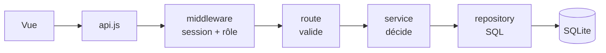

# Maths Collège

Plateforme de mathématiques pour le collège (6e → 3e) : cours, animations interactives, exercices générés aléatoirement, parcours en autonomie et suivi des élèves.

**Auteur : Gabriel Pizzo**, professeur de mathématiques.

---

## Ce qui est en place (version 0.1)

**Côté élève**
- Connexion avec l'identifiant et le mot de passe fournis par le professeur.
- **Tableau de bord** : bouton « Reprendre » qui ramène exactement à la dernière étape ouverte, prochaine étape du parcours, avancement par niveau, derniers scores.
- **Onglets 6e / 5e / 4e / 3e** : chaque niveau est un parcours ordonné de chapitres. Un chapitre se débloque quand le précédent est terminé.
- Chaque chapitre = une suite d'étapes : **cours** → **animation** → **exercices**. Une série d'exercices est validée à partir d'un score minimum (réglable par exercice).
- **Exercices libres** : tous les exercices, accessibles à tout moment, hors parcours. Les réussites comptent aussi pour le parcours. On y trouve aussi les exercices écrits par son professeur.
- Questions **différentes à chaque série** (générateurs aléatoires), correction détaillée après chaque réponse.
- **Jeux** : onglet commun à toutes les classes, avec un **classement global** (meilleur score par élève, toutes classes confondues, filtrable par période).

**Côté enseignant** (`/prof`)
- Création de classes (nom + niveau, année scolaire automatique).
- Création des comptes élèves **en lot** dans un tableur intégré (colonnes *Prénom*, *Nom*, *Identifiant*, *Mot de passe*) : on colle une sélection depuis Excel ou Google Sheets — une colonne « Prénom Nom » est séparée automatiquement. Identifiant et mot de passe sont choisis par vous ou générés (mots simples type `tigre47`).
- Export **CSV** et **impression de fiches** à découper pour distribuer les identifiants.
- Nouveau mot de passe, désactivation, remise à zéro de la progression, suppression.
- **Tableau de suivi** : élèves × chapitres, où chacun en est, dernière activité.
- **Mes chapitres** (`/prof/chapitres`) : tout le contenu d'un niveau dans l'ordre du parcours — réordonner, masquer, réécrire les chapitres livrés, écrire les siens. Voir plus bas.
- **Mes exercices** (`/prof/exercices`) : écrire ses propres exercices sans toucher au code, avec aperçu en direct. Voir plus bas.
- **Archivage** : classes, chapitres et exercices se rangent dans des archives au lieu d'être supprimés (fin d'année, contenu mis de côté). Les élèves ne voient plus ce qui est archivé ; rien n'est perdu et tout revient d'un clic.

**Contenu livré** : 2 chapitres complets par niveau (40 chapitres prévus, les autres apparaissent « Bientôt »).

| Niveau | Chapitres complets | Animations |
|---|---|---|
| 6e | Nombres entiers et décimaux, Fractions | Droite graduée avec zoom, Fractions en barres |
| 5e | Priorités opératoires, Nombres relatifs | Calcul pas à pas, Additions sur la droite |
| 4e | Calcul littéral (développer), Théorème de Pythagore | Modèle des aires, Carrés de Pythagore |
| 3e | Arithmétique, Fonctions affines, **Calcul littéral : développer** | Crible d'Ératosthène, Droite y = ax + b, Modèle des aires |

---

## Démarrer

Prérequis : **Node.js 22.9 ou plus récent**. Le fichier `.env` (copie de `.env.example`) est lu automatiquement.

```bash
npm install
npm run create-teacher -- gpizzo "un-mot-de-passe-solide" "Gabriel Pizzo"
npm start
```

Puis ouvrir http://localhost:3000, se connecter avec le compte enseignant, créer une classe et ses élèves.

Autres commandes :

| Commande | Rôle |
|---|---|
| `npm run dev` | Démarrage avec rechargement automatique |
| `npm test` | Tests automatiques (API complète + vérification de tous les exercices) |
| `npm run check-content` | Vérifie les fichiers de contenu avant mise en ligne |
| `npm run migrate` | Met la base de données à jour |

Variables d'environnement : voir `.env.example`.

---

## Ajouter du contenu (sans toucher au code)

Tout le contenu est dans `content/`, en JSON :

```
content/
  levels.json                    les 4 niveaux (sequential: true = déblocage dans l'ordre)
  chapters/5e/01-priorites-operatoires.json
  chapters/5e/90-a-venir.json     chapitres « Bientôt » (status: "draft")
```

Un chapitre :

```json
{
  "id": "5e-proportionnalite",
  "level": "5e",
  "order": 5,
  "title": "Proportionnalité et pourcentages",
  "status": "published",
  "steps": [
    { "id": "cours", "type": "lesson", "title": "Le cours",
      "blocks": [ { "type": "definition", "title": "…", "html": "Texte avec du LaTeX : $\\dfrac{3}{4}$" } ] },
    { "id": "anim", "type": "animation", "title": "…", "widget": "fraction-bars", "params": {} },
    { "id": "ex1", "type": "exercise", "title": "…", "generator": "frac-of-quantity", "count": 6, "pass": 5 }
  ]
}
```

- Types de blocs de cours : `definition`, `property`, `method`, `example`, `remark`, `text`.
- Les formules s'écrivent en LaTeX entre `$…$` (rendu par KaTeX).
- Pour publier un chapitre « Bientôt » : le déplacer dans son propre fichier, passer `status` à `published`, ajouter les étapes, lancer `npm run check-content`, redémarrer.
- **Nouveau type d'exercice** : une fonction dans `public/js/exercises/generators.js` (le contrat est décrit en haut du fichier), enregistrée dans `GENERATORS`. Les tests vérifient automatiquement que chaque question générée accepte sa propre bonne réponse.
- **Nouvelle animation** : une fonction dans `public/js/animations/widgets.js`, enregistrée dans `WIDGETS`.

---

## Mes chapitres : la page unique du contenu

`Mes classes` → **Mes chapitres**. Un onglet par niveau, et la liste de **tous** les chapitres dans l'ordre où les élèves les rencontreront — ceux livrés dans `content/` comme ceux que vous avez écrits, sans distinction d'emplacement. Pour chacun : monter, descendre, *Modifier*, *Voir*, et une **croix ✕** au bout de la ligne.

La croix fait disparaître le chapitre, pour vous comme pour vos élèves :

| | Effet de la ✕ | Récupérable ? |
|---|---|---|
| Chapitre que vous avez écrit | supprimé définitivement, avec la progression des élèves dessus | non — utilisez *Archiver* pour le ranger sans le perdre |
| Chapitre livré avec la plateforme | retiré du parcours | oui, depuis *Retirés du parcours* |

Un chapitre livré ne peut pas être effacé du disque : il est commun à tous les enseignants. Le retirer le fait disparaître de votre liste et de celle de vos élèves, ce qui revient au même pour vous.

Tout ce qui a été sorti du parcours — chapitres livrés retirés et chapitres personnels archivés — est replié en bas de la page, avec *Remettre dans le parcours* et, pour les vôtres, *Supprimer définitivement*.

Les chapitres livrés que vous avez retouchés affichent en plus *Version d'origine*.

**Les chapitres livrés sont modifiables.** Leur cours, écrit en HTML dans les fichiers, est reconverti en texte simple dans l'éditeur ; on y ajoute ou retire des blocs comme dans un chapitre à soi. Les fichiers de `content/` ne sont jamais réécrits : votre version est enregistrée à part et ne vaut que **pour vos classes** — un autre enseignant garde la version d'origine, et *Revenir à la version d'origine* efface vos modifications d'un clic. C'est aussi ainsi qu'on remplit un chapitre « Bientôt » pour le publier.

Un chapitre *masqué* reste dans votre liste mais disparaît du parcours des élèves.

---

## Écrire un chapitre depuis l'interface (cours + parcours)

**Mes chapitres** → *Nouveau chapitre*. Un chapitre écrit ici s'ajoute au parcours des classes concernées, exactement comme ceux de `content/` : même affichage, même déblocage, même suivi.

À gauche, **le parcours** : la suite des étapes, qu'on réordonne et supprime. On ajoute une étape *Cours*, *Animation* ou *Exercice*. À droite, l'étape en cours d'écriture.

Dans une étape **Cours**, on empile des blocs pré-définis — *Définition*, *Propriété*, *Méthode*, *Exemple*, *Remarque*, *Texte simple* — chacun avec son titre et son contenu, avec un **aperçu permanent** de ce que verra l'élève. La mise en forme acceptée est volontairement simple :

| On écrit | On obtient |
|---|---|
| `**gras**` / `*italique*` | **gras** / *italique* |
| `- ` en début de ligne | une liste à puces (`1.` pour une liste numérotée) |
| une ligne vide | un nouveau paragraphe |
| `$\dfrac{3}{4}$` | la formule, rendue par KaTeX |

Une étape **Animation** choisit une des animations fournies avec la plateforme ; une étape **Exercice** prend soit un type d'exercice intégré (avec son nombre de questions et son objectif), soit un de vos exercices écrits dans « Mes exercices ».

*Brouillon* = visible de vous seul ; *Publié* = dans le parcours de vos élèves. Le champ **Place dans le parcours** décide de l'ordre parmi les chapitres du niveau.

Le texte saisi n'est **jamais** inséré tel quel : il est échappé, puis seules les marques ci-dessus sont réinterprétées (`public/js/content/richtext.js`). Un chapitre écrit depuis l'interface ne peut donc pas injecter de HTML chez les élèves — contrairement aux fichiers de `content/`, écrits à la main et donc dignes de confiance.

---

## Écrire des exercices depuis l'interface (sans code)

`Mes classes` → **Mes exercices** → *Nouvel exercice*. Un exercice est un **modèle** : on décrit les nombres qui changent, et la plateforme génère des questions différentes à chaque série, comme les exercices intégrés.

1. **Les nombres qui changent** : chaque variable a un nom (`a`, `L`…) et un type — *entier* / *décimal* (bornes) ou *liste* (valeurs au choix).
2. **Conditions** (facultatif) : pour écarter les tirages qui ne conviennent pas — `a <> b`, `a > b`, `est_entier(a/b)` (division qui tombe juste).
3. **L'énoncé** : du texte, et les valeurs tirées entre **doubles crochets** — `Combien font $[[a]] \times [[b]]$ ?`. La mise en forme est celle des cours (voir le tableau plus haut) : LaTeX entre `$…$`, `**gras**`, `*italique*`, listes à puces avec `- `.
4. **La réponse**, au choix :
   - un **nombre** — une formule, ex. `a*b`, avec tolérance et unité facultatives ;
   - une **expression littérale** — on écrit l'expression attendue, ex. `-x-[[a]]`. L'élève peut répondre `-x-3`, `-3-x` ou `- x - 3`, c'est la même chose ; on peut exiger (ou non) une forme réduite. Degré 2 maximum ;
   - une **réponse écrite** — une ou plusieurs formulations acceptées, en ignorant la casse, les accents et la ponctuation finale ;
   - un **choix** à cliquer.
5. **La correction** : les `[[ ]]` y fonctionnent aussi — `$[[a]] \times [[b]] = [[a*b]]$`.

L'**aperçu de droite joue le modèle en direct** (bouton 🎲 pour retirer au sort) et signale les erreurs au fil de la frappe. *Brouillon* = visible de toi seul ; *Publié* = visible par tes élèves dans leurs exercices libres. Un exercice peut viser toutes tes classes ou une seule.

Dans les formules : `+ - * / % ^`, les comparaisons `< > <= >= = <>`, les liaisons `et / ou / non`, et les fonctions `abs, arrondi, plancher, plafond, racine, min, max, puissance, signe, carre, pgcd, ppcm, est_entier`.

Les formules ne sont **jamais** exécutées comme du code : elles sont analysées en arbre puis évaluées (`public/js/exercises/template.js`), côté navigateur pour générer les questions et côté serveur pour valider un modèle avant de l'enregistrer — les deux appliquent donc exactement les mêmes règles. Le texte saisi est échappé : seul le LaTeX et le `**gras**` sont interprétés.

---

## Les jeux et le classement

Les jeux sont communs à toutes les classes. Le premier, **les tables de multiplication**, propose quatre niveaux (*Découverte* 2→5, *Classique* 2→10, *Expert* 2→12, *Maître* avec des trous `7 × ? = 56`) et trois durées (30, 60, 120 s).

**Un classement par niveau et par durée** : on ne compare que des parties jouées dans les mêmes conditions. Chaque partie est rangée sous une « variante » `<niveau>|<durée>`, et le classement porte dessus — filtrable par période (semaine, mois, depuis toujours). Le classement reste global : tous les élèves de la plateforme y figurent, toutes classes confondues.

La partie s'ouvre sur un **décompte de 5 secondes** : la question reste cachée et le chrono ne part qu'au « Partez ! ».

**Barème**, annoncé aux élèves sur l'écran de jeu : 10 points par bonne réponse, plus 1 point par bonne réponse d'affilée (bonus plafonné à 10, donc 10 à 20 points par réponse) ; une erreur ne retire rien mais remet la série à zéro. Chaque gain s'affiche en « +13 » qui s'envole. Une musique de fond et des bruitages, entièrement synthétisés dans le navigateur (aucun fichier audio, conforme à la politique de sécurité), se coupent d'un clic — le choix est retenu.

Le serveur **recalcule les bornes** de chaque score reçu (niveau et durée connus, réponses possibles dans le temps imparti, points min et max par réponse) et rejette tout résultat hors d'atteinte.

### Ajouter un jeu

1. Déclarer le jeu dans `GAMES` (`server/services/games.js`) avec ses niveaux, ses durées autorisées et ses limites de score (`maxAnswersPerSecond`).
2. Écrire le jeu dans `public/js/games/`, qui expose une fonction de montage `(root, réglages, { onFinish })`.
3. L'enregistrer dans `GAME_UI` (`public/js/views/games.js`).

---

## Schéma du projet

```
                    NAVIGATEUR                        │              SERVEUR
                                                      │
  public/js/app.js ─── routeur, coquille, session     │   server/index.js ── démarrage, arrêt propre
         │                                            │          │
         ├── views/      un écran = un fichier        │   server/app.js ─── assemblage, injection
         │   login · dashboard · level · chapter      │          │
         │   free · custom-exercise · games           │          ├── middleware/  sécurité, session, rôles
         │   revision · teacher · parcours            │          │
         │   chapter-editor · exercise-editor         │          ├── routes/      valide, appelle, répond
         │   diagnostic · documents · fiche           │          │   auth · learning · teacher
         │                                            │          │   games · documents
         ├── exercises/  generators · template ◄──────┼──────────┤
         ├── content/    richtext ◄───────────────────┼───┐      ├── services/    toute la logique métier
         ├── animations/ widgets ◄────────────────────┼───┤      │   auth · accounts · progress
         ├── games/      tables · audio               │   │      │   content · chapters · exercises
         ├── math/       expr                         │   │      │   games · documents
         └── api.js      un seul client HTTP          │   │      │
                                                      │   │      ├── repositories/  SEUL endroit avec du SQL
                                                      │   │      │
                                        shared-modules.js ┘      └── db/          connexion + migrations
                                    (le serveur charge le code                         001 … 009
                                     du navigateur pour valider
                                      avec les mêmes règles)
```

**Le flux d'une requête** suit toujours le même chemin, sans raccourci :



Une vue ne parle jamais à une route sans passer par `api.js` ; une route ne contient aucune règle ; un service n'écrit jamais de SQL ; un repository ne décide de rien.

**Les données** se répartissent en trois familles :

| | Tables | Ce que ça garde |
|---|---|---|
| Comptes | `users`, `classes`, `sessions` | qui se connecte, et à quelle classe |
| Parcours | `step_progress`, `attempts`, `question_results`, `last_position`, `chapter_confidence` | ce que chaque élève a fait, raté et ressenti |
| Contenu de l'enseignant | `custom_chapters`, `chapter_overrides`, `custom_exercises`, `documents` | ce qu'il a écrit ou modifié par-dessus `content/` |
| Jeux | `game_scores` | une ligne par partie, base du classement |

Le programme livré vit dans `content/` (fichiers JSON), jamais en base : `services/chapters.js` fusionne les deux pour que le reste du code ignore d'où vient un chapitre.

---

## Architecture (pensée pour grandir)

```
server/
  config.js          toute la configuration (variables d'environnement)
  app.js             assemblage : dépendances injectées, aucune variable globale
  db/                connexion + migrations SQL numérotées
  repositories/      SEUL endroit qui contient du SQL
  services/          logique métier (auth, progression, comptes, contenu, exercices, jeux), indépendante d'Express
  routes/            API REST fine : valide, appelle un service, répond
  middleware/        sécurité, session, rôles, limitation
public/              application web sans étape de build (modules ES natifs)
  js/exercises/      générateurs intégrés + moteur des modèles écrits par l'enseignant
  js/content/        rendu sûr des cours écrits depuis l'interface
  js/games/          les jeux
content/             programme pédagogique en JSON, séparé du code
test/                tests automatiques (node --test)
```

Choix faits dès maintenant pour faciliter la montée en charge :

- **Couches séparées** : changer de base de données ne touche que `db/` et `repositories/`. Le SQL est volontairement portable vers PostgreSQL.
- **Contenu ≠ code** : le programme est de la donnée validée au démarrage. Les chapitres écrits depuis l'interface vivent en base et sont **fusionnés** avec ceux des fichiers par `server/services/chapters.js` : le reste de l'application ne sait pas d'où vient un chapitre.
- **Mêmes règles des deux côtés** : le code qui génère les questions et met en forme les cours est partagé entre le navigateur et le serveur (`server/shared-modules.js` charge les modules de `public/js/`). Impossible d'enregistrer un contenu que le navigateur ne saurait pas afficher.
- **Historique complet** : chaque série est enregistrée (`attempts`) en plus de l'état courant (`step_progress`). Les futures statistiques (temps passé, erreurs fréquentes, progression par compétence) pourront être calculées sans changer le schéma.
- **Sessions en base**, jeton aléatoire dont seule l'empreinte SHA-256 est stockée ; mots de passe hachés avec bcrypt. Changer un mot de passe ou désactiver un compte ferme ses sessions.
- **Multi-enseignants dès le départ** : chaque classe appartient à un enseignant, qui ne voit que ses élèves.
- **Sécurité** : en-têtes CSP stricts, aucune ressource externe (KaTeX et polices servis localement, conforme RGPD), protection CSRF (API JSON uniquement), limitation des tentatives de connexion par élève.
- **Exercices générés côté navigateur** : aucune charge serveur pendant qu'un élève travaille ; le serveur ne reçoit que le score.

### Prochaines étapes conseillées

1. **Hébergement** : un petit serveur (ou conteneur, voir `Dockerfile`) derrière nginx avec HTTPS. SQLite tient sans problème plusieurs centaines d'élèves simultanés.
2. **Au-delà d'un établissement** : passer à PostgreSQL (repositories) et déplacer la limitation de connexion dans Redis pour lancer plusieurs instances.
3. **Vérification des réponses côté serveur** si l'enjeu devient évaluatif (aujourd'hui un élève averti pourrait falsifier son score d'exercice ; les scores de jeu sont déjà bornés côté serveur, mais pas recalculés question par question).
4. Éditeur de contenu en ligne pour l'enseignant, devoirs assignés à une classe avec date limite, export des résultats.
5. Connexion via l'ENT (CAS / OpenID Connect) à la place des identifiants distribués.

---

## Mettre en ligne

### Avant de déployer

```bash
npm run verify     # valide le contenu pédagogique puis lance toute la suite de tests
```

C'est aussi ce que fait la vérification automatique à chaque envoi sur GitHub (`.github/workflows/ci.yml`), qui construit l'image Docker en plus.

### Avec Docker

```bash
docker build -t maths-college .
docker run -d --name maths --restart unless-stopped \
  -p 127.0.0.1:3000:3000 \
  -v maths-data:/app/data \
  -e TEACHER_USERNAME=gpizzo \
  -e TEACHER_PASSWORD='un-mot-de-passe-long-et-unique' \
  -e TEACHER_NAME='Gabriel Pizzo' \
  maths-college
```

Le volume `maths-data` contient **toute** la mémoire de la plateforme : la base SQLite et les PDF déposés. C'est lui qu'il faut sauvegarder, et lui seul.

Le compte enseignant n'est créé qu'au tout premier démarrage, et seulement si aucun n'existe. Les variables peuvent être retirées ensuite.

### Derrière nginx, en HTTPS

L'application écoute en HTTP sur le port 3000 et fait confiance au proxy local (`trust proxy: loopback`). Le cookie de session passe en `Secure` dès que `NODE_ENV=production` : **servir le site en HTTPS n'est pas optionnel**, sinon personne ne reste connecté.

```nginx
server {
  server_name maths.exemple.fr;
  client_max_body_size 30M;        # les PDF déposés peuvent peser jusqu'à 20 Mo

  location / {
    proxy_pass http://127.0.0.1:3000;
    proxy_set_header Host $host;
    proxy_set_header X-Forwarded-For $proxy_add_x_forwarded_for;
    proxy_set_header X-Forwarded-Proto $scheme;
  }
}
```

### Sauvegarder

```bash
docker run --rm -v maths-data:/data -v "$PWD":/sortie alpine \
  tar czf /sortie/maths-$(date +%F).tar.gz -C /data .
```

La base contient des **données d'élèves** : noms, identifiants, progression. La sauvegarde doit être traitée comme telle — chiffrée au repos, et pas déposée n'importe où.

### Points de vigilance

- **Le port 3000 n'est pas exposé publiquement** dans la commande ci-dessus (`127.0.0.1:3000`) : seul nginx y accède.
- **`.env` ne doit jamais entrer dans le dépôt** ; `.gitignore` et `.dockerignore` l'excluent déjà.
- **Les scores d'exercices sont calculés par le navigateur.** Un élève averti peut en falsifier un. Les scores de jeux, eux, sont bornés côté serveur. Tant que la plateforme sert à s'entraîner, c'est sans conséquence ; si elle devient évaluative, il faudra vérifier les réponses côté serveur.
- **Une seule instance à la fois.** SQLite et la limitation des connexions vivent en mémoire d'un seul processus. Pour passer à plusieurs instances : PostgreSQL et Redis (voir plus bas).

---

## Licence

© Gabriel Pizzo. **Tous droits réservés.** Ce dépôt est consultable publiquement, mais le code et le contenu pédagogique ne sont pas sous licence libre : toute réutilisation, modification ou redistribution demande mon accord écrit préalable.

---

Conçu par **Gabriel Pizzo**.
