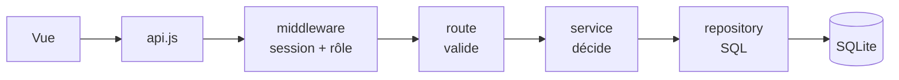

# Maths Collège

Plateforme de mathématiques pour le collège (6e → 3e) : cours, animations interactives, exercices générés aléatoirement, parcours en autonomie et suivi des élèves.

**Auteur : Gabriel Pizzo**, professeur de mathématiques.

---

## Ce qui est en place (version 0.1)

**Côté élève**
- Connexion avec l'identifiant et le mot de passe fournis par le professeur.
- **Tableau de bord** : bouton « Reprendre » qui ramène exactement à la dernière étape ouverte, prochaine étape du parcours, avancement par niveau, derniers scores.
- **Onglets 6e / 5e / 4e / 3e** : chaque niveau est un parcours ordonné de chapitres. Un chapitre se débloque quand le précédent est terminé.
- Chaque chapitre = une suite d'étapes : **cours** → **animation** → **exercices**. Une série d'exercices est validée à partir d'un score minimum (réglable par exercice).
- **Exercices libres** : tous les exercices, accessibles à tout moment, hors parcours. Les réussites comptent aussi pour le parcours. On y trouve aussi les exercices écrits par son professeur.
- Questions **différentes à chaque série** (générateurs aléatoires), correction détaillée après chaque réponse.
- **Séances** : onglet à part pour les activités et feuilles d'exercices données pour une heure de cours. Hors parcours : jamais verrouillées, elles ne verrouillent rien.
- **Jeux** : onglet commun à toutes les classes, avec un **classement global** (meilleur score par élève, toutes classes confondues, filtrable par période).
- **Traduction** (bouton 🌐) : afficher le cours et l'interface dans une autre langue, pour les élèves allophones. Désactivée tant qu'aucun service de traduction n'est configuré — voir « Traduction » plus bas.

**Côté enseignant** (`/prof`)
- Création de classes (nom + niveau, année scolaire automatique).
- Création des comptes élèves **en lot** : on indique *combien* de comptes il faut, tout est tiré au sort (pseudonyme, identifiant, mot de passe) et reste modifiable à la main dans le tableur intégré. **Aucun nom d'élève n'est demandé ni stocké** — voir « Pseudonymes et RGPD » plus bas.
- Export **CSV** et **impression de fiches** à découper pour distribuer les identifiants. Le CSV contient une colonne *Élève* vide : c'est là que vous notez qui est qui, dans votre propre tableur.
- Nouveau mot de passe, désactivation, remise à zéro de la progression, suppression.
- **Tableau de suivi** : élèves × chapitres, où chacun en est, dernière activité.
- **Mes chapitres** (`/prof/chapitres`) : tout le contenu d'un niveau dans l'ordre du parcours — réordonner, masquer, réécrire les chapitres livrés, écrire les siens. Voir plus bas.
- **Mes séances** (`/prof/seances`) : publier une activité ou une feuille d'exercices pour une heure de cours, hors parcours. Même éditeur que les chapitres.
- **Mes exercices** (`/prof/exercices`) : écrire ses propres exercices sans toucher au code, avec aperçu en direct. Voir plus bas.
- **Archivage** : classes, chapitres et exercices se rangent dans des archives au lieu d'être supprimés (fin d'année, contenu mis de côté). Les élèves ne voient plus ce qui est archivé ; rien n'est perdu et tout revient d'un clic.

**Contenu livré** : 2 à 3 chapitres complets par niveau (41 chapitres prévus, les autres apparaissent « Bientôt »).

Les trois gestes de 6e — **encadrer**, **intercaler**, **arrondir** — sont découpés par rang : un jeu et un
exercice **à l'unité**, puis un jeu et un exercice **au dixième**. Deux moments de cours différents, donc
deux étapes différentes ; on ne va pas jusqu'au centième, qui n'ajoute pas d'idée nouvelle à ce stade.
Dans les jeux, l'élève **écrit** sa réponse — le dessin sert d'appui, il ne se clique pas.

| Niveau | Chapitres complets | Animations |
|---|---|---|
| 6e | Nombres entiers et décimaux, Fractions, **Angles** | Droite graduée avec zoom, **6 jeux de décimaux** (encadrer, intercaler, arrondir — à l'unité puis au dixième) et leur **défi**, Fractions en barres, **Mesurer un angle**, **Construire un angle** |
| 5e | Priorités opératoires, Nombres relatifs | Calcul pas à pas, Additions sur la droite |
| 4e | Calcul littéral (développer), Théorème de Pythagore | Modèle des aires, Carrés de Pythagore |
| 3e | Arithmétique, Fonctions affines, **Calcul littéral : développer** | Crible d'Ératosthène, Droite y = ax + b, Modèle des aires |

---

## Pseudonymes et RGPD

La plateforme **ne stocke aucune donnée nominative sur les élèves**. Un compte élève, c'est :

| | |
|---|---|
| un **identifiant de connexion** | `loutre.curieuse` |
| un **pseudonyme** affiché partout | *Loutre curieuse* |
| une **classe** | 6e A |

C'est tout : pas de prénom, pas de nom, pas de date de naissance, pas d'adresse. Le lien
pseudonyme → élève est tenu par l'enseignant, **hors de la plateforme**, dans sa propre feuille de
calcul. Le CSV proposé après la création des comptes contient déjà la colonne vide prévue pour ça.

Conséquence pratique : un classement de jeu, une liste de classe ou un diagnostic « Où ça coince »
peuvent s'afficher, se projeter au tableau ou se partager — ils ne nomment personne.

**Les pseudonymes sont tirés au sort** parmi 1 152 combinaisons *animal + qualité*, accordées en genre
(« Loutre curieuse », « Renard curieux »), sans chiffre et faciles à lire à voix haute, puisqu'ils se
distribuent en classe. Ils sont uniques : un pseudonyme déjà pris n'est jamais proposé deux fois.

### Si vous aviez déjà des comptes avec des noms

La migration `011_pseudonymes.js` s'en occupe au premier démarrage, et dans cet ordre :

1. elle **exporte** les prénoms, noms, identifiants et classes dans
   `data/correspondance-pseudonymes-AAAA-MM-JJ.csv`, avec le nouveau pseudonyme en première colonne ;
2. elle attribue un pseudonyme à chaque compte ;
3. elle **supprime** les colonnes `first_name` et `last_name` de la base.

> **Ce fichier CSV est la seule copie du lien pseudonyme ↔ élève.** Rangez-le hors de la plateforme
> (il est déjà exclu de git par `.gitignore`), et supprimez-le du serveur une fois recopié.

---

## Démarrer

Prérequis : **Node.js 22.9 ou plus récent**. Le fichier `.env` (copie de `.env.example`) est lu automatiquement.

```bash
npm install
npm run create-teacher -- gpizzo "un-mot-de-passe-solide" "Gabriel Pizzo"
npm start
```

Puis ouvrir http://localhost:3000, se connecter avec le compte enseignant, créer une classe et ses élèves.

Autres commandes :

| Commande | Rôle |
|---|---|
| `npm run dev` | Démarrage avec rechargement automatique |
| `npm test` | Tests automatiques (API complète + vérification de tous les exercices) |
| `npm run check-content` | Vérifie les fichiers de contenu avant mise en ligne |
| `npm run migrate` | Met la base de données à jour |

Variables d'environnement : voir `.env.example`.

---

## Ajouter du contenu (sans toucher au code)

Tout le contenu est dans `content/`, en JSON :

```
content/
  levels.json                    les 4 niveaux (sequential: true = déblocage dans l'ordre)
  chapters/5e/01-priorites-operatoires.json
  chapters/5e/90-a-venir.json     chapitres « Bientôt » (status: "draft")
```

Un chapitre :

```json
{
  "id": "5e-proportionnalite",
  "level": "5e",
  "order": 5,
  "title": "Proportionnalité et pourcentages",
  "status": "published",
  "steps": [
    { "id": "cours", "type": "lesson", "title": "Le cours",
      "blocks": [ { "type": "definition", "title": "…", "html": "Texte avec du LaTeX : $\\dfrac{3}{4}$" } ] },
    { "id": "anim", "type": "animation", "title": "…", "widget": "fraction-bars", "params": {} },
    { "id": "ex1", "type": "exercise", "title": "…", "generator": "frac-of-quantity", "count": 6, "pass": 5 }
  ]
}
```

- Types de blocs de cours : `definition`, `property`, `method`, `example`, `remark`, `text`.
- Les formules s'écrivent en LaTeX entre `$…$` (rendu par KaTeX).
- Pour publier un chapitre « Bientôt » : le déplacer dans son propre fichier, passer `status` à `published`, ajouter les étapes, lancer `npm run check-content`, redémarrer.
- **Nouveau type d'exercice** : une fonction dans `public/js/exercises/generators.js` (le contrat est décrit en haut du fichier), enregistrée dans `GENERATORS`. Les tests vérifient automatiquement que chaque question générée accepte sa propre bonne réponse.
- **Nouvelle animation** : une fonction dans `public/js/animations/widgets.js`, enregistrée dans `WIDGETS`.

---

## Mes chapitres : la page unique du contenu

`Mes classes` → **Mes chapitres**. Un onglet par niveau, et la liste de **tous** les chapitres dans l'ordre où les élèves les rencontreront — ceux livrés dans `content/` comme ceux que vous avez écrits, sans distinction d'emplacement. Pour chacun : monter, descendre, *Modifier*, *Voir*, et une **croix ✕** au bout de la ligne.

La croix fait disparaître le chapitre, pour vous comme pour vos élèves :

| | Effet de la ✕ | Récupérable ? |
|---|---|---|
| Chapitre que vous avez écrit | supprimé définitivement, avec la progression des élèves dessus | non — utilisez *Archiver* pour le ranger sans le perdre |
| Chapitre livré avec la plateforme | retiré du parcours | oui, depuis *Retirés du parcours* |

Un chapitre livré ne peut pas être effacé du disque : il est commun à tous les enseignants. Le retirer le fait disparaître de votre liste et de celle de vos élèves, ce qui revient au même pour vous.

Tout ce qui a été sorti du parcours — chapitres livrés retirés et chapitres personnels archivés — est replié en bas de la page, avec *Remettre dans le parcours* et, pour les vôtres, *Supprimer définitivement*.

Les chapitres livrés que vous avez retouchés affichent en plus *Version d'origine*.

**Les chapitres livrés sont modifiables.** Leur cours, écrit en HTML dans les fichiers, est reconverti en texte simple dans l'éditeur ; on y ajoute ou retire des blocs comme dans un chapitre à soi. Les fichiers de `content/` ne sont jamais réécrits : votre version est enregistrée à part et ne vaut que **pour vos classes** — un autre enseignant garde la version d'origine, et *Revenir à la version d'origine* efface vos modifications d'un clic. C'est aussi ainsi qu'on remplit un chapitre « Bientôt » pour le publier.

Un chapitre *masqué* reste dans votre liste mais disparaît du parcours des élèves.

---

## Écrire un chapitre depuis l'interface (cours + parcours)

**Mes chapitres** → *Nouveau chapitre*. Un chapitre écrit ici s'ajoute au parcours des classes concernées, exactement comme ceux de `content/` : même affichage, même déblocage, même suivi.

À gauche, **le parcours** : la suite des étapes, qu'on réordonne et supprime. On ajoute une étape *Cours*, *Animation* ou *Exercice*. À droite, l'étape en cours d'écriture.

Dans une étape **Cours**, on empile des blocs pré-définis — *Définition*, *Propriété*, *Méthode*, *Exemple*, *Remarque*, *Texte simple* — chacun avec son titre et son contenu, avec un **aperçu permanent** de ce que verra l'élève. La mise en forme acceptée est volontairement simple :

| On écrit | On obtient |
|---|---|
| `**gras**` / `*italique*` | **gras** / *italique* |
| `- ` en début de ligne | une liste à puces (`1.` pour une liste numérotée) |
| une ligne vide | un nouveau paragraphe |
| `$\dfrac{3}{4}$` | la formule, rendue par KaTeX |

Une étape **Animation** choisit une des animations fournies avec la plateforme ; une étape **Exercice** prend soit un type d'exercice intégré (avec son nombre de questions et son objectif), soit un de vos exercices écrits dans « Mes exercices ».

*Brouillon* = visible de vous seul ; *Publié* = dans le parcours de vos élèves. Le champ **Place dans le parcours** décide de l'ordre parmi les chapitres du niveau.

Le texte saisi n'est **jamais** inséré tel quel : il est échappé, puis seules les marques ci-dessus sont réinterprétées (`public/js/content/richtext.js`). Un chapitre écrit depuis l'interface ne peut donc pas injecter de HTML chez les élèves — contrairement aux fichiers de `content/`, écrits à la main et donc dignes de confiance.

---

## Écrire des exercices depuis l'interface (sans code)

`Mes classes` → **Mes exercices** → *Nouvel exercice*. Un exercice est un **modèle** : on décrit les nombres qui changent, et la plateforme génère des questions différentes à chaque série, comme les exercices intégrés.

1. **Les nombres qui changent** : chaque variable a un nom (`a`, `L`…) et un type — *entier* / *décimal* (bornes) ou *liste* (valeurs au choix).
2. **Conditions** (facultatif) : pour écarter les tirages qui ne conviennent pas — `a <> b`, `a > b`, `est_entier(a/b)` (division qui tombe juste).
3. **L'énoncé** : du texte, et les valeurs tirées entre **doubles crochets** — `Combien font $[[a]] \times [[b]]$ ?`. La mise en forme est celle des cours (voir le tableau plus haut) : LaTeX entre `$…$`, `**gras**`, `*italique*`, listes à puces avec `- `.
4. **La réponse**, au choix :
   - un **nombre** — une formule, ex. `a*b`, avec tolérance et unité facultatives ;
   - une **expression littérale** — on écrit l'expression attendue, ex. `-x-[[a]]`. L'élève peut répondre `-x-3`, `-3-x` ou `- x - 3`, c'est la même chose ; on peut exiger (ou non) une forme réduite. Degré 2 maximum ;
   - une **réponse écrite** — une ou plusieurs formulations acceptées, en ignorant la casse, les accents et la ponctuation finale ;
   - un **choix** à cliquer.
5. **La correction** : les `[[ ]]` y fonctionnent aussi — `$[[a]] \times [[b]] = [[a*b]]$`.

L'**aperçu de droite joue le modèle en direct** (bouton 🎲 pour retirer au sort) et signale les erreurs au fil de la frappe. *Brouillon* = visible de toi seul ; *Publié* = visible par tes élèves dans leurs exercices libres. Un exercice peut viser toutes tes classes ou une seule.

Dans les formules : `+ - * / % ^`, les comparaisons `< > <= >= = <>`, les liaisons `et / ou / non`, et les fonctions `abs, arrondi, plancher, plafond, racine, min, max, puissance, signe, carre, pgcd, ppcm, est_entier`.

Les formules ne sont **jamais** exécutées comme du code : elles sont analysées en arbre puis évaluées (`public/js/exercises/template.js`), côté navigateur pour générer les questions et côté serveur pour valider un modèle avant de l'enregistrer — les deux appliquent donc exactement les mêmes règles. Le texte saisi est échappé : seul le LaTeX et le `**gras**` sont interprétés.

---

## Traduction (élèves allophones)

Le bouton 🌐 de la barre du haut affiche le cours et l'interface dans une autre langue. Seize langues
sont proposées — celles qu'on croise le plus en classe, plus les langues vivantes du collège.

**Le navigateur de l'élève ne parle jamais au traducteur.** Il demande au serveur, qui appelle le
fournisseur et garde le résultat en cache (`translations`). Aucune adresse IP d'élève ne sort, la
politique de sécurité du site (CSP) reste fermée, et un paragraphe de cours n'est traduit qu'une fois
pour toute la classe. Ce qui part : le texte affiché — jamais un pseudonyme, un identifiant, un score.

Rien n'est activé par défaut : sans fournisseur, le bouton annonce simplement que la traduction n'est
pas disponible. Pour l'activer, deux possibilités dans `.env` :

```bash
# 1. LibreTranslate — logiciel libre, auto-hébergeable, gratuit
TRANSLATE_PROVIDER=libretranslate
TRANSLATE_URL=https://mon-instance-libretranslate
# TRANSLATE_KEY=…        (si votre instance en demande une)

# 2. Google Cloud Translation (API v2) — facturé à l'usage
TRANSLATE_PROVIDER=google
TRANSLATE_KEY=votre-clé-api
```

**Limite connue.** La traduction remplace le texte *à l'intérieur* du HTML déjà construit, nœud par
nœud. Une phrase coupée par un mot en gras part donc en deux morceaux chez le traducteur, ce qui donne
parfois une tournure maladroite. C'est le prix à payer pour que les formules (KaTeX), les figures et la
mise en page restent intactes, et pour qu'un cours à moitié traduit reste lisible.

---

## Les jeux et le classement

Les jeux sont communs à toutes les classes. Le premier, **les tables de multiplication**, propose quatre niveaux (*Découverte* 2→5, *Classique* 2→10, *Expert* 2→12, *Maître* avec des trous `7 × ? = 56`) et trois durées (30, 60, 120 s).

**Un classement par niveau et par durée** : on ne compare que des parties jouées dans les mêmes conditions. Chaque partie est rangée sous une « variante » `<niveau>|<durée>`, et le classement porte dessus — filtrable par période (semaine, mois, depuis toujours). Le classement reste global : tous les élèves de la plateforme y figurent, toutes classes confondues.

La partie s'ouvre sur un **décompte de 5 secondes** : la question reste cachée et le chrono ne part qu'au « Partez ! ».

**Barème**, annoncé aux élèves sur l'écran de jeu : 10 points par bonne réponse, plus 1 point par bonne réponse d'affilée (bonus plafonné à 10, donc 10 à 20 points par réponse) ; une erreur ne retire rien mais remet la série à zéro. Chaque gain s'affiche en « +13 » qui s'envole. Une musique de fond et des bruitages, entièrement synthétisés dans le navigateur (aucun fichier audio, conforme à la politique de sécurité), se coupent d'un clic — le choix est retenu.

Le serveur **recalcule les bornes** de chaque score reçu (niveau et durée connus, réponses possibles dans le temps imparti, points min et max par réponse) et rejette tout résultat hors d'atteinte.

### Ajouter un jeu

1. Déclarer le jeu dans `GAMES` (`server/services/games.js`) avec ses niveaux, ses durées autorisées et ses limites de score (`maxAnswersPerSecond`).
2. Écrire le jeu dans `public/js/games/`, qui expose une fonction de montage `(root, réglages, { onFinish })`.
3. L'enregistrer dans `GAME_UI` (`public/js/views/games.js`).

---

## Schéma du projet

> **Schéma graphique complet** : [`docs/architecture.html`](docs/architecture.html) — six vues
> (architecture générale, cycle d'un exercice, typologies de publication, verrouillage du parcours,
> données conservées, traduction). À ouvrir dans un navigateur.

```
                    NAVIGATEUR                        │              SERVEUR
                                                      │
  public/js/app.js ─── routeur, coquille, session     │   server/index.js ── démarrage, arrêt propre
         │                                            │          │
         ├── views/      un écran = un fichier        │   server/app.js ─── assemblage, injection
         │   login · dashboard · level · chapter      │          │
         │   free · custom-exercise · games           │          ├── middleware/  sécurité, session, rôles
         │   revision · teacher · parcours · seances  │          │
         │   chapter-editor · exercise-editor         │          ├── routes/      valide, appelle, répond
         │   diagnostic · documents · fiche           │          │   auth · learning · teacher
         │                                            │          │   games · documents · translate
         ├── exercises/  generators · template        │          │
         │               random (graine) ◄────────────┼──────────┤
         ├── content/    richtext ◄───────────────────┼───┐      ├── services/    toute la logique métier
         ├── animations/ widgets · angles ◄───────────┼───┤      │   auth · accounts · pseudonyms
         │               decimaux                     │   │      │   progress · series · content
         ├── games/      tables · audio               │   │      │   chapters · exercises · games
         ├── math/       expr                         │   │      │   documents · translate
         ├── translate.js  le bouton 🌐               │   │      │
         └── api.js      un seul client HTTP          │   │      ├── repositories/  SEUL endroit avec du SQL
                                                      │   │      │
                                        shared-modules.js ┘      └── db/          connexion + migrations
                                    (le serveur charge le code                         001 … 013
                                     du navigateur pour valider
                                      avec les mêmes règles)
```

**Le flux d'une requête** suit toujours le même chemin, sans raccourci :



Une vue ne parle jamais à une route sans passer par `api.js` ; une route ne contient aucune règle ; un service n'écrit jamais de SQL ; un repository ne décide de rien.

**Les données** se répartissent en trois familles :

| | Tables | Ce que ça garde |
|---|---|---|
| Comptes | `users`, `classes`, `sessions` | qui se connecte, et à quelle classe. `users.display_name` est le **pseudonyme** |
| Parcours | `step_progress`, `attempts`, `question_results`, `last_position`, `chapter_confidence`, `exercise_sessions` | ce que chaque élève a fait, raté et ressenti ; et la graine de chaque série en cours |
| Contenu de l'enseignant | `custom_chapters`, `chapter_overrides`, `custom_exercises`, `documents` | ce qu'il a écrit ou modifié par-dessus `content/`. `custom_chapters.kind` distingue chapitre et séance |
| Jeux | `game_scores` | une ligne par partie, base du classement |
| Service | `translations`, `schema_migrations` | le texte déjà traduit, par langue ; les migrations appliquées |

Le programme livré vit dans `content/` (fichiers JSON), jamais en base : `services/chapters.js` fusionne les deux pour que le reste du code ignore d'où vient un chapitre.

---

## Architecture (pensée pour grandir)

```
server/
  config.js          toute la configuration (variables d'environnement)
  app.js             assemblage : dépendances injectées, aucune variable globale
  db/                connexion + migrations SQL numérotées
  repositories/      SEUL endroit qui contient du SQL
  services/          logique métier (auth, progression, comptes, contenu, exercices, jeux), indépendante d'Express
  routes/            API REST fine : valide, appelle un service, répond
  middleware/        sécurité, session, rôles, limitation
public/              application web sans étape de build (modules ES natifs)
  js/exercises/      générateurs intégrés + moteur des modèles écrits par l'enseignant
  js/content/        rendu sûr des cours écrits depuis l'interface
  js/games/          les jeux
content/             programme pédagogique en JSON, séparé du code
test/                tests automatiques (node --test)
```

Choix faits dès maintenant pour faciliter la montée en charge :

- **Couches séparées** : changer de base de données ne touche que `db/` et `repositories/`. Le SQL est volontairement portable vers PostgreSQL.
- **Contenu ≠ code** : le programme est de la donnée validée au démarrage. Les chapitres écrits depuis l'interface vivent en base et sont **fusionnés** avec ceux des fichiers par `server/services/chapters.js` : le reste de l'application ne sait pas d'où vient un chapitre.
- **Mêmes règles des deux côtés** : le code qui génère les questions et met en forme les cours est partagé entre le navigateur et le serveur (`server/shared-modules.js` charge les modules de `public/js/`). Impossible d'enregistrer un contenu que le navigateur ne saurait pas afficher.
- **Historique complet** : chaque série est enregistrée (`attempts`) en plus de l'état courant (`step_progress`). Les futures statistiques (temps passé, erreurs fréquentes, progression par compétence) pourront être calculées sans changer le schéma.
- **Sessions en base**, jeton aléatoire dont seule l'empreinte SHA-256 est stockée ; mots de passe hachés avec bcrypt. Changer un mot de passe ou désactiver un compte ferme ses sessions.
- **Multi-enseignants dès le départ** : chaque classe appartient à un enseignant, qui ne voit que ses élèves.
- **Sécurité** : en-têtes CSP stricts, aucune ressource externe (KaTeX et polices servis localement, conforme RGPD), protection CSRF (API JSON uniquement), limitation des tentatives de connexion par élève.
- **Exercices générés côté navigateur, corrigés côté serveur.** Le serveur ouvre une série en tirant une graine, qu'il retient ; le navigateur tire les questions de cette graine, l'élève répond avec une correction immédiate et sans latence ; puis le serveur **rejoue exactement la même série** pour compter lui-même les bonnes réponses. Le navigateur n'envoie jamais de score, seulement ce qui a été tapé. Un élève qui poste un faux résultat depuis sa console obtient zéro.

### Prochaines étapes conseillées

1. **Hébergement** : un petit serveur (ou conteneur, voir `Dockerfile`) derrière nginx avec HTTPS. SQLite tient sans problème plusieurs centaines d'élèves simultanés.
2. **Au-delà d'un établissement** : passer à PostgreSQL (repositories) et déplacer la limitation de connexion dans Redis pour lancer plusieurs instances.
3. **Scores de jeu** : ils sont bornés, pas recalculés. Si un classement devenait un enjeu, il faudrait y appliquer le même principe que les exercices.
4. Éditeur de contenu en ligne pour l'enseignant, devoirs assignés à une classe avec date limite, export des résultats.
5. Connexion via l'ENT (CAS / OpenID Connect) à la place des identifiants distribués.

---

## Mettre en ligne

### Avant de déployer

```bash
npm run verify     # valide le contenu pédagogique puis lance toute la suite de tests
```

C'est aussi ce que fait la vérification automatique à chaque envoi sur GitHub (`.github/workflows/ci.yml`), qui construit l'image Docker en plus.

### Avec Docker

```bash
docker build -t maths-college .
docker run -d --name maths --restart unless-stopped \
  -p 127.0.0.1:3000:3000 \
  -v maths-data:/app/data \
  -e TEACHER_USERNAME=gpizzo \
  -e TEACHER_PASSWORD='un-mot-de-passe-long-et-unique' \
  -e TEACHER_NAME='Gabriel Pizzo' \
  maths-college
```

Le volume `maths-data` contient **toute** la mémoire de la plateforme : la base SQLite et les PDF déposés. C'est lui qu'il faut sauvegarder, et lui seul.

Le compte enseignant n'est créé qu'au tout premier démarrage, et seulement si aucun n'existe. Les variables peuvent être retirées ensuite.

### Derrière nginx, en HTTPS

L'application écoute en HTTP sur le port 3000 et fait confiance au proxy local (`trust proxy: loopback`). Le cookie de session passe en `Secure` dès que `NODE_ENV=production` : **servir le site en HTTPS n'est pas optionnel**, sinon personne ne reste connecté.

```nginx
server {
  server_name maths.exemple.fr;
  client_max_body_size 30M;        # les PDF déposés peuvent peser jusqu'à 20 Mo

  location / {
    proxy_pass http://127.0.0.1:3000;
    proxy_set_header Host $host;
    proxy_set_header X-Forwarded-For $proxy_add_x_forwarded_for;
    proxy_set_header X-Forwarded-Proto $scheme;
  }
}
```

### Sauvegarder

```bash
docker run --rm -v maths-data:/data -v "$PWD":/sortie alpine \
  tar czf /sortie/maths-$(date +%F).tar.gz -C /data .
```

La base contient des **données d'élèves** : pseudonymes, identifiants, mots de passe hachés, progression.
Aucun nom, mais la sauvegarde reste à traiter sérieusement — chiffrée au repos, et pas déposée n'importe où.
Le fichier `data/correspondance-pseudonymes-*.csv`, lui, contient bien des noms : il doit quitter le
serveur dès qu'il a été recopié dans votre tableur.

### Points de vigilance

- **Le port 3000 n'est pas exposé publiquement** dans la commande ci-dessus (`127.0.0.1:3000`) : seul nginx y accède.
- **`.env` ne doit jamais entrer dans le dépôt** ; `.gitignore` et `.dockerignore` l'excluent déjà. Le dossier `data/` non plus — il contient la base, les PDF déposés et l'export des identités.
- **La traduction envoie du texte à un tiers** si vous la configurez avec Google. Ce texte est le contenu pédagogique affiché, jamais une donnée d'élève ; une instance LibreTranslate auto-hébergée évite la question.
- **Les scores d'exercices sont vérifiés par le serveur** (voir l'architecture). Les scores de jeux, eux, sont seulement *bornés* : le serveur vérifie qu'un résultat est atteignable, pas qu'il a été réellement obtenu — un jeu de rapidité ne se rejoue pas question par question.
- **Une seule instance à la fois.** SQLite et la limitation des connexions vivent en mémoire d'un seul processus. Pour passer à plusieurs instances : PostgreSQL et Redis (voir plus bas).

---

## Licence

© Gabriel Pizzo. **Tous droits réservés.** Ce dépôt est consultable publiquement, mais le code et le contenu pédagogique ne sont pas sous licence libre : toute réutilisation, modification ou redistribution demande mon accord écrit préalable.

---

Conçu par **Gabriel Pizzo**.
